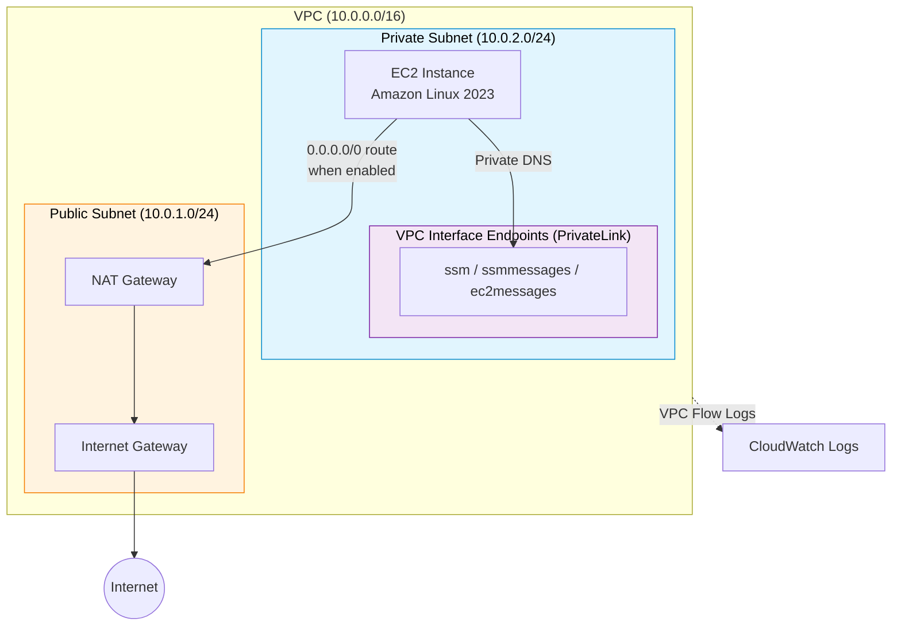
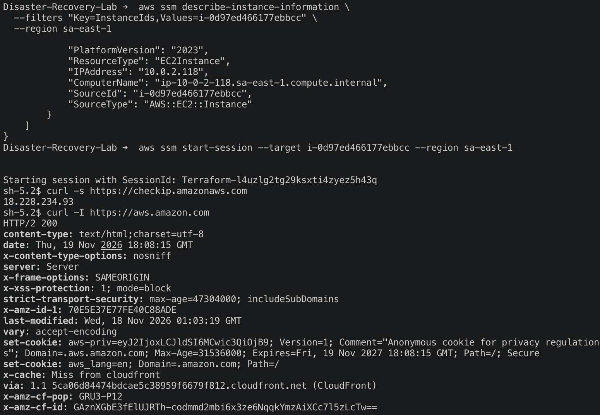
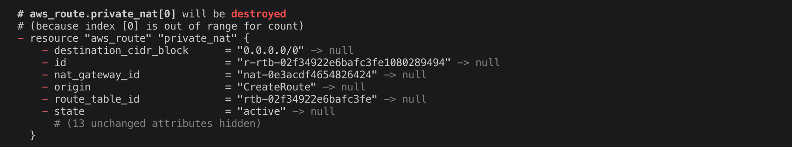
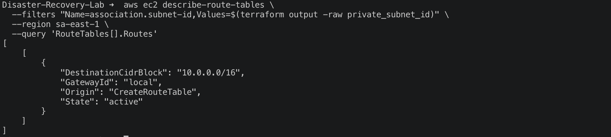
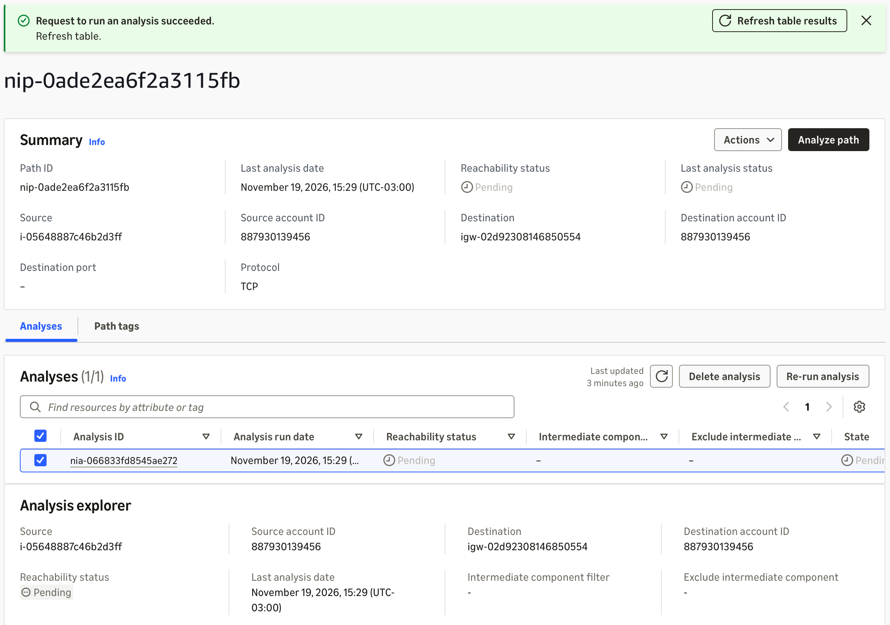
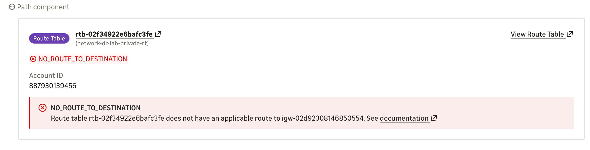
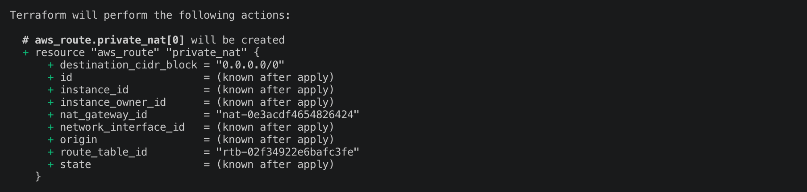

# AWS Network Disaster Recovery & Troubleshooting Lab


Hands-on lab simulating a production network outage in an AWS private subnet (accidental removal of the default `0.0.0.0/0` route to the NAT Gateway). Demonstrates structured root-cause diagnosis using AWS-native observability tools and automated remediation via Infrastructure as Code (Terraform).

**Ideal for:**
- Technical & behavioral interviews (*"Tell me about a time you diagnosed and resolved a network outage"*)
- AWS SysOps / CloudOps / SRE troubleshooting practice
- Demonstrating drift-free IaC recovery workflows

---

## Architecture



### Key Components
- **Network:** Custom VPC with one Public Subnet and one Private Subnet (single-AZ for cost optimization).
- **Routing & Egress:** Internet Gateway (IGW) + NAT Gateway controlled by a Terraform boolean toggle (`enable_private_outbound`).
- **Compute:** Amazon Linux 2023 EC2 instance isolated in the private subnet (no public IP, no SSH port open, no bastion host).
- **Access:** AWS Systems Manager (**SSM Session Manager**) backed by VPC Interface Endpoints (`ssm`, `ssmmessages`, `ec2messages`).
- **Observability:** VPC Flow Logs streaming to Amazon CloudWatch Logs + VPC Reachability Analyzer.

---

## Cost Estimate

| Resource | Estimated Cost (us-east-1 / sa-east-1) | Notes |
| :--- | :--- | :--- |
| **NAT Gateway** | ~$0.045 – $0.062 / hour | + data processing charges |
| **Interface VPC Endpoints (x3)** | ~$0.01 – $0.013 / hour each | Charged per AZ per hour |
| **EC2 (`t3.micro`)** | ~$0.01 / hour | Free Tier eligible |
| **CloudWatch Flow Logs** | < $0.01 | Minimal ingestion for lab traffic |

> **Warning:** Run `terraform destroy` immediately after completing the lab to avoid ongoing hourly charges from the NAT Gateway and VPC Interface Endpoints.

---

## Prerequisites

- AWS CLI v2 configured with permissions to manage VPC, EC2, IAM, SSM, and CloudWatch resources
- Terraform `>= 1.5`
- [AWS Session Manager Plugin](https://docs.aws.amazon.com/systems-manager/latest/userguide/session-manager-working-with-install-plugin.html) installed locally

---

## Lab Walkthrough

### 1. Deploy the Baseline (Healthy State)

```bash
terraform init
terraform apply
```

Note the key outputs generated by Terraform:
- `private_instance_id`
- `ssm_connect_command`
- `flow_log_group`

### 2. Validate Outbound Connectivity

Connect to the private EC2 instance via SSM Session Manager:

```bash
aws ssm start-session --target <INSTANCE-ID> --region sa-east-1
```

Inside the instance shell, verify outbound internet access through the NAT Gateway:

```bash
curl -s https://checkip.amazonaws.com   # Should return the NAT Gateway's Elastic IP
curl -I https://aws.amazon.com          # Should return HTTP/2 200
```


*Outbound connectivity confirmed via the NAT Gateway's public IP.*

---

### 3. Simulate the Outage

Simulate an accidental route deletion by updating `terraform.tfvars`:

```hcl
enable_private_outbound = false
```

Apply the change:

```bash
terraform apply
```

This removes the `0.0.0.0/0 -> nat-gateway` route from the private subnet's route table, leaving only the local VPC route (`10.0.0.0/16`).


*Terraform destroying the default route in the private route table.*


*CLI verification showing only the local VPC route remaining.*

---

### 4. Diagnose the Outage

#### Symptoms
1. Existing SSM sessions freeze and new connections fail with `TargetNotConnected`.
2. All outbound internet traffic from the private subnet times out.

#### Diagnostic Steps

1. **Route Table Inspection (AWS CLI)**
   ```bash
   aws ec2 describe-route-tables \
     --filters "Name=association.subnet-id,Values=<PRIVATE-SUBNET-ID>" \
     --query "RouteTables[].Routes"
   ```
   **Finding:** The `0.0.0.0/0` route pointing to the NAT Gateway is missing.

2. **Path Validation (VPC Reachability Analyzer)**
   - **Source:** Private EC2 Instance
   - **Destination:** Internet Gateway
   - **Protocol / Port:** TCP `443`
   - **Result:** `Not reachable` (`No route to destination` on the private route table).

   

   

3. **Traffic Verification (VPC Flow Logs)**
   - Queried the CloudWatch Log Group via **CloudWatch Logs Insights** to verify that outbound packets to external IPs were no longer generating `ACCEPT` records toward the NAT Gateway ENI.

#### Root Cause
The default route (`0.0.0.0/0`) to the NAT Gateway was removed from the private subnet's route table, blackholing all external egress traffic.

#### Engineering Observation (SSM Behavior)
Even with SSM Interface Endpoints and Private DNS enabled, the SSM Agent lost its `Online` status after the route change. In real-world environments, this underscores the importance of validating **Endpoint Security Groups** (allowing inbound TCP `443` from the VPC CIDR) and testing PrivateLink isolation paths independently—rather than assuming endpoint presence guarantees uninterrupted control-plane access during routing changes.

---

### 5. Automated Recovery (IaC Remediation)

Restore the desired network state in `terraform.tfvars`:

```hcl
enable_private_outbound = true
```

Re-apply the configuration:

```bash
terraform apply
```

Once Terraform recreates the route and the instance status returns to `Online` in Fleet Manager, reconnect via SSM and verify `curl` succeeds again.


*Route table restored via Terraform and outbound connectivity verified.*

---

### 6. Cleanup

Tear down all lab infrastructure to stop billing:

```bash
terraform destroy
```

---

## Repository Structure

```text
.
├── main.tf             # VPC, Subnets, IGW, NAT Gateway, EC2, SSM Endpoints, and Flow Logs
├── variables.tf        # Input variables including the `enable_private_outbound` failure toggle
├── outputs.tf          # Instance ID, SSM session command, and CloudWatch Log Group name
├── terraform.tfvars    # Variable definitions for lab state control
└── README.md           # Lab documentation and troubleshooting walkthrough
```